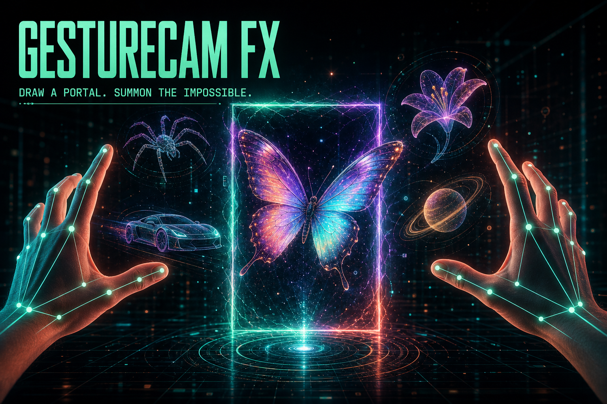

# GestureCam FX — AI Portal Lab

GestureCam FX is a real-time augmented-reality hand-gesture experience. One left-hand pinch creates a smart, automatically sized portal. Each new right-hand pinch gives the current 3D model its own cinematic exit, dissolves it into particles, and materializes the next one.



**[Launch the live experience](https://shihabbk18.github.io/gesturecam-fx/)**

The [original demo address](https://shihabbk18.github.io/PORTFOLIO-/gesturecam-fx/) remains available as a compatibility deployment.

## The experience

1. Start the camera and allow browser camera access.
2. Pinch your left thumb and index finger once to create the portal.
3. Pinch once with your right hand to launch the current model and cycle to the next.
4. Repeat the right-hand pinch to explore all ten models.

The model sequence is:

- Prism Butterfly
- Cyber Spider
- Neon Roadster
- Solar Bloom
- Orbit Planet
- Nova Rocket
- Aqua Jelly
- Metro Bot
- Void Crystal
- Pulse Saucer

## Features

- Two-hand tracking with 21 MediaPipe landmarks per hand
- Normalized pinch detection that adapts to hand distance
- One-pinch smart portal creation plus optional custom pointer drawing
- Ten original, procedurally built Three.js models
- Model-specific exits: the car races, butterfly flies, spider crawls, rocket launches, UFO warps, and more
- Cinematic particle disintegration and rematerialization transitions
- Neon portal effects, scanner, and hand skeleton overlays
- Camera selector, screenshot capture, fullscreen, and hand-label swap
- Mouse and keyboard fallbacks for visitors without camera access
- Responsive HUD for desktop and mobile
- Camera frames remain inside the browser and are never uploaded

## Fallback controls

| Control | Action |
| --- | --- |
| Mouse/touch click | Create a smart portal |
| Mouse/touch drag | Draw a custom portal |
| Right-click | Show the next model |
| Space / Right Arrow | Show the next model |
| R | Clear the portal |
| F | Toggle fullscreen |

## Run locally

Use Node.js 24 or newer.

```powershell
cd frontend
npm install
npm run dev
```

Open the local URL printed by Vite, click **Start camera**, and grant camera access. Chrome or Edge is recommended for the smoothest webcam experience.

## Build

```powershell
cd frontend
npm run build
```

The production site is generated in `frontend/dist`. GitHub Actions installs locked dependencies, builds the app, runs lint and regression tests, and deploys successful pushes to `master` or `main` to this repository's GitHub Pages site. Pull requests run verification without publishing.

## Verify changes

```powershell
cd frontend
npm ci
npm run lint
npm test
npm run build
```

Regression tests cover camera selection, permission and playback failures, cancellation when entering demo mode or leaving the page, and retrying failed or stalled tracker downloads. Physical webcam tracking still requires a browser with camera permission. Select a camera from the controls to switch the active stream.

## Tech stack

- React + Vite
- MediaPipe Hands
- Three.js + WebGL procedural 3D
- Canvas 2D camera and HUD rendering
- Lucide React icons
- GitHub Pages

## Architecture

The live experience is frontend-only. `App.jsx` manages camera access, gesture state, pointer controls, and the HUD. `scene.js` handles hand math and the camera/portal overlay. `three-portal.js` builds and animates the 3D collection, per-model exits, particle disintegration, and WebGL rendering. The older FastAPI scaffold remains in the repository as historical project context but is not needed by the portal lab.
