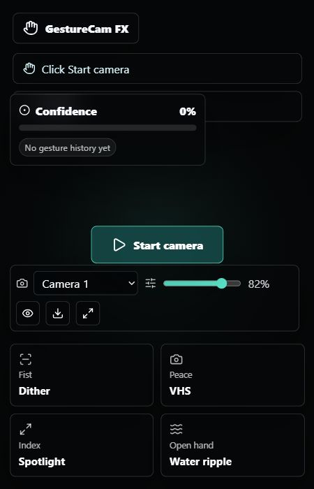

# GestureCam FX

GestureCam FX is a fullscreen webcam experience that uses MediaPipe Hands to track 21 hand landmarks, detect live gestures, and map each gesture to a visual filter on the camera feed.



## Features

- Fullscreen webcam canvas with mirrored preview
- MediaPipe Hands landmark tracking
- White dot on the index fingertip
- Gesture detection from 21 landmarks
- Live visual filters mapped to gestures
- Camera selector for multiple webcams
- Filter intensity slider
- Fingertip dot toggle
- Screenshot download
- Fullscreen button
- FPS monitor
- Gesture confidence meter
- Recent gesture history
- Mobile-friendly HUD layout

## Gesture Map

| Gesture | Filter |
| --- | --- |
| Fist | Dither |
| Peace sign | VHS with chromatic aberration |
| Pointing index finger | Spotlight |
| Open hand | Water ripple |

## Tech Stack

- React + Vite
- MediaPipe Hands
- Canvas 2D rendering
- Lucide React icons
- CSS responsive HUD

The repository also still contains the FastAPI backend scaffold from the earlier AI detector version, but the webcam gesture app runs from the frontend only.

## Run Locally

Install and start the frontend:

```powershell
cd "C:\Users\NuRuL AzAm\Documents\SHIHAB\frontend"
npm install
npm run dev
```

Open:

```text
http://localhost:5173/
```

Click **Start camera**, allow camera permission, and press `F11` for browser fullscreen.

## Troubleshooting

If the page is black:

- Refresh the page and click **Start camera** again.
- Check browser camera permission for `localhost:5173`.
- Try Chrome or Edge if the in-app browser blocks camera access.
- Use the camera selector if your laptop has multiple camera devices.

If camera permission was blocked:

```text
Chrome/Edge Settings > Privacy and security > Site settings > Camera
```

Set `localhost:5173` to **Allow**.

## How It Works

MediaPipe returns 21 hand landmarks. The app checks finger extension states using landmark positions, estimates gesture confidence from finger spread and landmark distances, then draws the webcam frame and active effect to a fullscreen canvas. The index fingertip dot is drawn from landmark `8`.

## Portfolio Upgrade Ideas

- Add two-hand gestures
- Add a TensorFlow.js gesture classifier
- Add video recording
- Add filter presets
- Add a landmark debug overlay
- Add WebGL shader filters for higher performance
